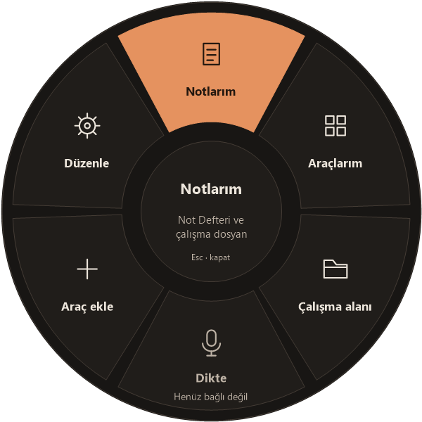
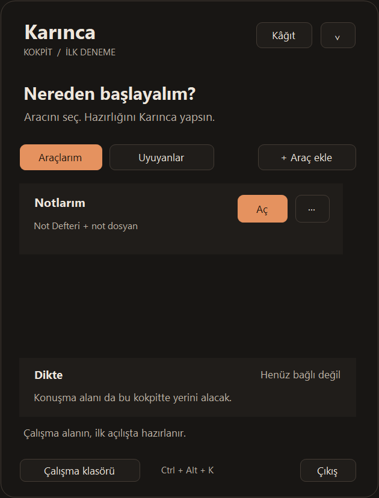

> 🚧 **Status: active development.** It works for the author; interfaces may change.

# karinca-kokpit-mvp

A small Windows prototype of a "cockpit": a floating capsule that opens a **radial selection wheel** (like the weapon wheel in a shooter) where you pick the tool or folder you want with one mouse move and click. It is the first, deliberately throwaway experiment for a larger idea: remove the setup and "where did I put that" friction before you start real work.




Both images are renders of the app's own windows (`--render-wheel`, `--render`), not desktop screenshots.

The interface is in Turkish. A Turkish version of this file is in [README.tr.md](README.tr.md).

## What it does

- A small capsule stays on screen. Hover or click it (or press `Ctrl+Alt+K`) to open the wheel; `Esc`, a click in the middle, or moving the mouse away closes it.
- Wheel slices: **Notes** (prepares a notes file in the workspace and opens it in Notepad), **Tools** (a second wheel with the programs you added, paged when there are many), **Workspace** (opens the folder), **Add tool**, **Edit** (management panel). A **Dictation** slice exists but is not wired yet and cannot be triggered by accident.
- You add your own programs or shortcuts (file picker, or drop one `.exe`/`.lnk` on the panel). A tool can be put to **sleep** (hidden but kept) and brought back. Tools are started only on your explicit click, with no shell-command string building.
- Dark and "paper" light themes, capsule position remembered, keyboard navigation (arrows/Tab, Enter, Esc).
- Local only: no network access, no account, no scanning of installed programs. State is one JSON file (`data/kokpit.json`) written atomically with a backup; a corrupt file is set aside, not deleted. The notes file is created with `CreateNew`, so existing text is never overwritten. Exiting closes only the cockpit, never the programs it started.

## Quick start

Requirements: Windows 10/11 with the built-in .NET Framework 4 C# compiler (`csc.exe`, C# 5). Nothing is downloaded.

```bat
build.cmd
build\KarincaCark.exe
```

Built-in checks (each prints its result lines; exit code 0 means all passed):

```bat
build\KarincaCark.exe --check          :: 26 core checks (state file, tool validation, recovery)
build\KarincaCark.exe --wheel-check    :: 32 wheel checks (geometry, cancel, keyboard, sub-wheel, paging, real launch)
build\KarincaCark.exe --context-check  :: 10 window lifecycle checks
build\KarincaCark.exe --ui-check       :: 17 panel/event checks (layout scale factors 1, 1.25, 1.5)
build\KarincaCark.exe --render-wheel "<output-folder>"   :: renders the wheel to PNG (dark/light)
```

The checks use isolated temporary folders under `build\checks` and start only their own test helper (`build\checks-bin\LaunchProbe.exe`).

## Limits and unverified claims

- **A prototype, not a product.** The technology (WinForms, C# 5) was chosen for speed of a first look, not as a lasting decision; later work on the idea moved to a different codebase that is not published here. No installer, signing, auto-update, or telemetry.
- The wheel is custom-drawn; slices do not yet expose screen-reader (UI Automation) elements. Keyboard navigation exists, but this is not an accessibility claim.
- DPI: the layout is checked against scale factors, not against real monitors with different DPIs; no per-monitor DPI v2.
- The window checks run inside a test session, not as a real user at a real desktop. In particular, returning to the window of a modern packaged Notepad that hands over its process has not been tried with a user.
- The CI job runs the build and the core checks as a gate; the window checks run there as informational steps because hosted runners do not guarantee an interactive desktop.
- Tested on Windows 11 only. No Mac or Linux version.
- Custom tool arguments, terminal/project selection and agent-specific preparation are not implemented.

## License

Apache-2.0, see [LICENSE](LICENSE) and [NOTICE](NOTICE).
